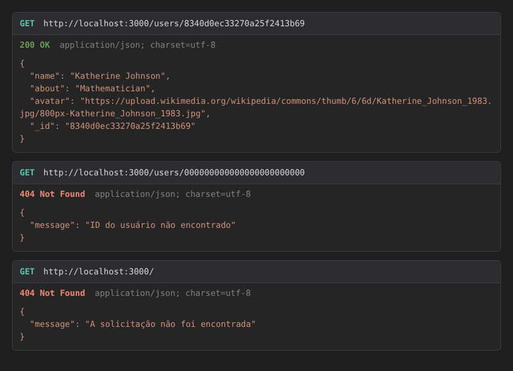

# 🌍 Around The U.S. — API com Express

## 📝 Descrição do Projeto

**Around The U.S.** é a galeria de lugares construída nas Sprints 8 a 14 do
curso de Desenvolvimento Web da TripleTen Brasil. Até aqui, o front-end
conversava com o servidor da TripleTen. Este repositório é o começo do
**próprio back-end** do projeto: um servidor Node.js com Express que entrega
os usuários e os cartões em JSON.

Nesta primeira etapa, os dados vêm de arquivos JSON na pasta `data`. O banco de
dados entra na próxima sprint, e o front-end ainda não está ligado a este
servidor.



---

## 🚩 Funcionalidades

| Requisição | Resposta |
| --- | --- |
| `GET /users` | `200` — a lista de usuários de `data/users.json` |
| `GET /cards` | `200` — a lista de cartões de `data/cards.json` |
| `GET /users/:id` | `200` — o usuário com esse `_id` |
| `GET /users/:id` com um id inexistente | `404` — `{ "message": "ID do usuário não encontrado" }` |
| qualquer outro endereço, inclusive `/` | `404` — `{ "message": "A solicitação não foi encontrada" }` |
| endereço malformado (ex.: `/users/%E0`) | `400` — `{ "message": "Requisição inválida" }` |
| falha ao ler ou interpretar um arquivo de dados | `500` — `{ "message": "Ocorreu um erro no servidor" }` |

Toda resposta de erro tem só o campo `message`. O servidor não cai com
requisições inválidas e não deixa erros no console.

---

## 🛠 Tecnologias e técnicas

- **Node.js** e **Express 5**: rotas com `express.Router()`, uma por recurso
  (`routes/users.js`, `routes/cards.js`), montadas no `app.js` com
  `app.use('/users', ...)`
- **Módulo `fs`** (`fs.promises.readFile`) para ler os arquivos de dados, e
  **`path.join(__dirname, ...)`** para montar os caminhos, independente da
  pasta de onde o servidor é iniciado e do sistema operacional
- **Promessas** com `.then()` / `.catch()`: um arquivo ausente ou um JSON
  quebrado viram resposta `500`, nunca uma exceção sem tratamento
- **Middlewares** no fim da fila: um para o `404` geral e um **tratador de
  erros** (quatro parâmetros) que responde em JSON
- Busca do usuário por `_id` com `Array.prototype.find`
- **nodemon** para a recarga automática em desenvolvimento
- **ESLint 8.56** com o guia de estilo **Airbnb** (`airbnb-base`), com uma
  exceção para `_id`
- **EditorConfig** e `.gitattributes` com finais de linha LF, para o lint
  passar igual no Windows, no macOS e no Linux

---

## 📐 Estrutura do Projeto

```
├── data/
│   ├── cards.json
│   └── users.json
├── images/                ← imagem do README
├── routes/
│   ├── cards.js
│   └── users.js
├── .editorconfig
├── .eslintrc
├── .gitattributes
├── .gitignore
├── app.js                 ← ponto de entrada
└── package.json
```

---

## 💻 Como executar localmente

```bash
npm install
npm run start   # servidor em http://localhost:3000
npm run dev     # o mesmo, reiniciando a cada arquivo salvo
npm run lint    # ESLint
```

Para testar as rotas, use o Postman ou o próprio navegador:
`http://localhost:3000/users/8340d0ec33270a25f2413b69`.

---

## 📈 Próximos passos

1. Guardar os dados no MongoDB, com o Mongoose
2. Criar, editar e excluir usuários e cartões (POST, PATCH, DELETE)
3. Ligar o front-end em React a este servidor

---

## 👤 Autor

**Leonardo Dias Caumo** — _Desenvolvido como parte do portfólio de estudos em Desenvolvimento Web da TripleTen Brasil._
